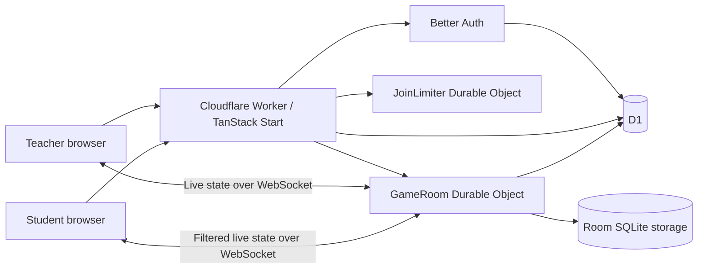

# Architecture and code map

[Documentation index](README.md) · [Development](DEVELOPMENT.md) · [Database schema](DATABASE_SCHEMA.md)

This describes the current single-teacher implementation. Proposed multi-teacher
changes are in [future features](FUTURE_FEATURES.md).

## System overview

The Worker serves the React application and API requests. TanStack Start handles
server rendering, routes and server functions. A separate live API validates
requests and routes them to Durable Objects. The browser does not choose the
teacher owner, control authoritative timers or award its own points.

## Main flows

### Teacher access and authoring

Better Auth stores accounts and sessions in D1 through Drizzle. The server checks
the configured teacher email as well as the session. Registration also requires
the private setup code and closes after the account exists. Google is configured
only when both credentials are present.

Quiz server functions validate data and scope queries/mutations to the signed-in
owner. Example quizzes are static server-side content; saving an edited example
creates account-backed content. Browser-only drafts are copied only through an
explicit, validated migration action.

### Live game

The teacher opens a room with a copy of a quiz. The live API checks the teacher
session and creates room metadata. A `GameRoom` Durable Object persists the quiz
snapshot, phase, deadlines, players and answers in its SQLite storage.

Students join with a code and nickname. Reconnect proofs use random tokens whose
hashes are stored server-side; the browser receives an HttpOnly room cookie.
The API assigns host/student roles after validation. Room code alone does not
authorize host commands or establish a returning player identity.

The server accepts the first answer and controls reveal/scoring. Alarms advance
automatic timers even if a host disconnects. Client views are filtered for the
role and display setting, so a student does not receive future questions or the
correct answer before reveal. WebSockets carry updates and host commands after
the authorized upgrade. Session checks also protect a returning host.

### Reports and exports

At game end, the final report is saved idempotently to D1 and retried after a
transient failure. The teacher reads reports through owner-scoped server functions.
The browser generates downloads. PDF rendering is loaded on demand; report exports
are not sent to an external PDF service.

### Email and social previews

React Email templates render on the server for account messages. Provider settings
select Resend, the optional Cloudflare Email binding, or SMTP; credentials remain
server-side. The account UI receives configuration status rather than credentials.

Social metadata is rendered in initial HTML. Static branded PNGs are public assets.
Preview copy excludes quiz/report content and reset tokens. See
[the social policy](SOCIAL_PREVIEWS.md).

## Where to make a change

| Area | Main files/directories |
| --- | --- |
| Routes and root document | [`src/routes`](../src/routes), [`src/router.tsx`](../src/router.tsx) |
| Worker entry and live routing | [`src/server.ts`](../src/server.ts), [`src/server/live-api.ts`](../src/server/live-api.ts) |
| Live persistence and sockets | [`src/server/game-room.ts`](../src/server/game-room.ts) |
| Quiz validation/model | [`src/lib/quiz.ts`](../src/lib/quiz.ts), [`src/lib/quiz-storage.ts`](../src/lib/quiz-storage.ts) |
| Account-backed quiz operations | [`src/lib/quizzes.functions.ts`](../src/lib/quizzes.functions.ts) |
| Authentication and recovery | [`src/lib/auth.server.ts`](../src/lib/auth.server.ts), [`src/lib/recovery.server.ts`](../src/lib/recovery.server.ts) |
| Pure game transitions | [`src/lib/live/engine.ts`](../src/lib/live/engine.ts) |
| Shared game messages and views | [`src/lib/live/protocol.ts`](../src/lib/live/protocol.ts), [`src/lib/live/view.ts`](../src/lib/live/view.ts) |
| Browser connection handling | [`src/lib/live/use-live-room.ts`](../src/lib/live/use-live-room.ts) |
| Teacher/quiz/live screens | [`src/components/quiz`](../src/components/quiz), [`src/components/live`](../src/components/live) |
| Shared UI primitives | [`src/components/ui`](../src/components/ui) |
| Theme and styling | [`src/styles.css`](../src/styles.css), [`src/theme.css`](../src/theme.css), [`src/lib/theme.ts`](../src/lib/theme.ts) |
| Audio policy and playback | [`src/lib/live/audio-policy.ts`](../src/lib/live/audio-policy.ts), [`src/lib/live/game-audio.ts`](../src/lib/live/game-audio.ts) |
| Emails/provider delivery | [`src/emails`](../src/emails), [`src/lib/auth-email.server.ts`](../src/lib/auth-email.server.ts) |
| Reports/PDF | [`src/lib/live/report-export.ts`](../src/lib/live/report-export.ts), [`src/lib/live/report-pdf.tsx`](../src/lib/live/report-pdf.tsx) |
| Schema and migrations | [`src/db/schema.ts`](../src/db/schema.ts), [`migrations`](../migrations) |
| Social metadata and artwork | [`src/lib/social.ts`](../src/lib/social.ts), [`scripts/social-card.ts`](../scripts/social-card.ts), [`public/og`](../public/og) |
| Deployment tooling | [`scripts/private-deploy.ts`](../scripts/private-deploy.ts), [`scripts/deploy-worker.ts`](../scripts/deploy-worker.ts) |

## Boundaries to preserve

- Authenticate and authorize on the server, including server functions and socket
  upgrades. A hidden button is not an access-control boundary.
- Validate untrusted input before persistence or room transitions. Derive identity
  and ownership from the session/cookie, not caller-supplied owner IDs.
- Filter game state before sending it to clients; visual hiding cannot protect a
  correct answer already included in a response.
- Keep deadline/scoring changes idempotent and persisted. Duplicate messages,
  reconnects and object eviction must not award points twice.
- Keep secrets and deployment identifiers out of tracked files and client bundles.
  Preserve the explicit public/private target checks before remote operations.
- Preserve legacy browser-storage keys when changing visible branding, so existing
  drafts and preferences remain accessible.

Internal live endpoints and server-function URLs are implementation details, not
a versioned public integration API. Discuss a stable integration contract before
building a third-party client against them.
