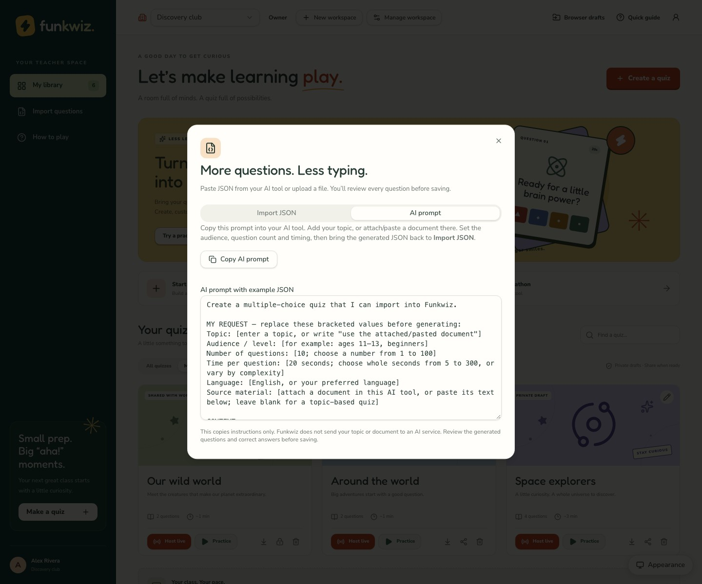

# Question imports and quiz exports

[Documentation index](README.md) · [Teacher guide](TEACHER_GUIDE.md)

Funkwiz currently imports **one quiz as JSON**. CSV import, direct PDF/Word import
and automatic extraction are not implemented. You can prepare a question set in
another tool, but it must match the format below and be reviewed before saving.

## Format

```json
{
  "title": "A little space adventure",
  "description": "A quick trip around our solar system.",
  "questions": [
    {
      "prompt": "Which planet is known as the Red Planet?",
      "answers": ["Venus", "Mars", "Jupiter", "Saturn"],
      "correctIndex": 1,
      "duration": 20
    }
  ]
}
```

`correctIndex` counts from **zero**: `0` is the first choice, `1` the second, `2`
the third and `3` the fourth. In the example, the correct answer is **Mars**.

| Field          | Required     | Rules                                                                            |
| -------------- | ------------ | -------------------------------------------------------------------------------- |
| `title`        | Yes          | A nonempty string, at most 120 characters.                                       |
| `description`  | No           | A string; text beyond 500 characters is truncated.                               |
| `cover`        | No           | `space`, `nature`, `world` or `confetti`; missing/unknown values use `confetti`. |
| `questions`    | Yes          | An array of 1–100 question objects.                                              |
| `prompt`       | Per question | A nonempty string, at most 1,000 characters.                                     |
| `answers`      | Per question | Exactly four nonempty strings, each at most 240 characters.                      |
| `correctIndex` | Per question | A whole number from `0` to `3`.                                                  |
| `duration`     | No           | A whole number of seconds from `5` to `300`; defaults to `20`.                   |

Titles, prompts and answers have surrounding whitespace removed. Length checks
apply to the supplied strings before trimming. Import text is limited to 500,000
characters, displayed in the app as a 500 KB limit. Uploaded files also have a
500,000-byte limit. For multibyte text these are different measures; keep
comfortably below both limits.

Download or copy the [two-question example](quiz-import-example.json) as a starting
point. IDs and timestamps are not required: importing creates fresh quiz/question
IDs and a new account draft rather than overwriting an existing quiz.

## Ask an AI tool to prepare your quiz

Open **Import → AI prompt** and choose **Copy AI prompt**. The prompt includes the
same sample JSON as the import form and the validation rules above. Replace its
bracketed instructions with your topic, learner level, question count (1–100),
language and timing (5–300 seconds per question).

Paste it into your preferred AI tool. For a document-based quiz, attach the
PDF/Word file in that tool or paste readable source text alongside the prompt.
Ask it to use that material; if it cannot access the attachment, provide text.
For a topic-based quiz, a topic such as “photosynthesis for ages 11–13” is enough.

The prompt requests a single JSON object without code fences and reminds the AI
that answer indexes start at zero. Bring its response back to **Import JSON**,
then review every question and correct answer before saving. The prompt is
separate from the JSON: do not paste the prompt into the quiz JSON field or add
it as a JSON property.

Funkwiz does not call an AI service or send the document anywhere. You choose
what to provide to your external AI tool. If automatic clipboard access is
unavailable, the app selects the prompt so you can copy it manually.

[](screenshots/ai-import.jpg)

## Import and review

1. Sign in and open **Import** from the teacher library.
2. Paste JSON or upload a JSON file containing one quiz object.
3. Review validation errors and correct the source if needed.
4. Review the questions in the editor, including every correct-answer selection.
5. Save the quiz to your teacher account, then use **Practice** before class.

Pasting into the import dialog is not the same as saving a quiz. Invalid data is
rejected. Valid imports still need a human check for factual accuracy and suitable
wording. There is one correct choice per question; multi-select and free-text
answers are not supported yet.

## Export and reuse

The export action on a library quiz downloads quiz JSON. Import it on another
installation to create a new quiz there. The import deliberately assigns fresh IDs.
It does not transfer your account, live rooms or reports.

Report JSON from **Download report** has a different structure and is not accepted
as a question import. Keep quiz backups separate from learner-result exports.

## Common errors

| Error                         | Check                                                                                                     |
| ----------------------------- | --------------------------------------------------------------------------------------------------------- |
| JSON cannot be read           | Use double quotes, remove trailing commas and include only the JSON object, without Markdown code fences. |
| Incorrect number of questions | Provide 1–100 items in `questions`.                                                                       |
| Incorrect answer count        | Provide exactly four strings in `answers`, even if only two choices seem necessary.                       |
| Wrong `correctIndex`          | Use a number from 0 to 3, not the answer text or a one-based position.                                    |
| Invalid duration              | Use integer seconds, such as `30`, rather than `"30s"`, decimals or milliseconds.                         |
| Import too large              | Split the material into smaller quizzes and shorten long text.                                            |

Source of truth: [`src/lib/quiz.ts`](../src/lib/quiz.ts) and
[`src/lib/quiz-storage.ts`](../src/lib/quiz-storage.ts).
