# A look inside Funkwiz

[Project overview](../README.md) · [Documentation index](README.md) · [Try it locally](GETTING_STARTED.md)

These are real screens from a running Funkwiz installation, using a fictional
teacher, quizzes and six fictional students. Click a desktop image to enlarge it.
The library shows opt-in School mode; Personal mode has the same quiz/game tools
with a single teacher and no workspace-management controls.

## Your questions, ready for the next class

Keep private drafts, choose colorful covers and explicitly share quizzes with
colleagues in your workspace.

[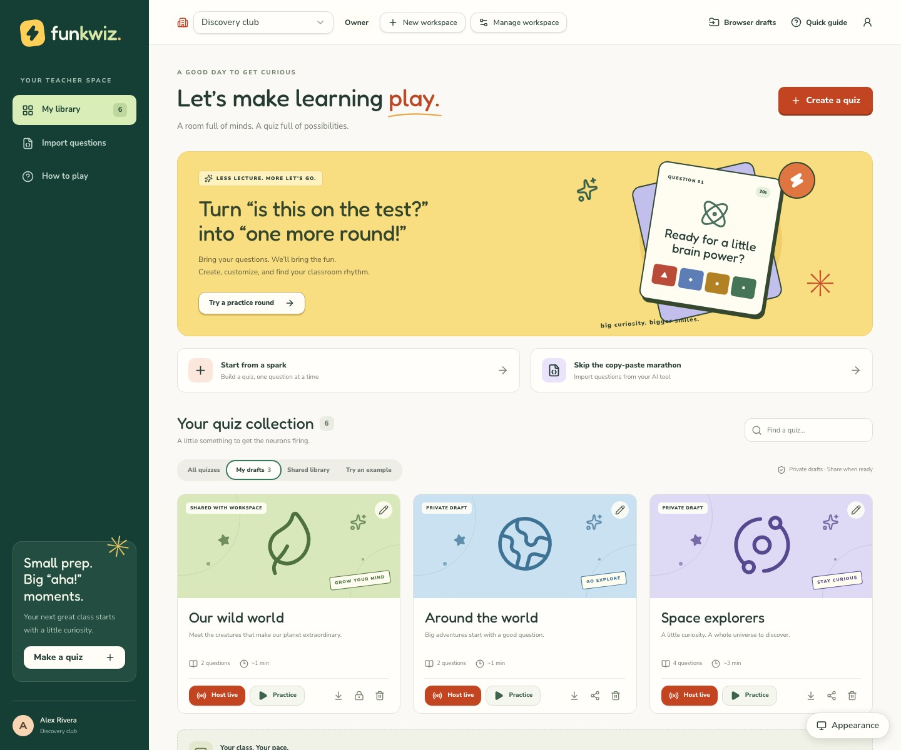](screenshots/library.jpg)

## A little prep goes a long way

Write four answer choices, mark the correct one and set a duration for each
question. The common-time control can apply the same duration across the quiz.

[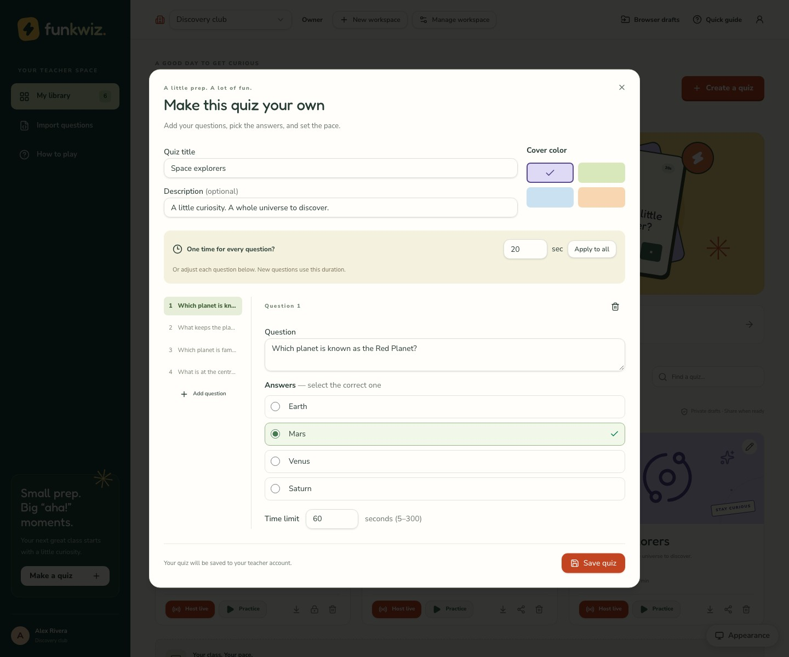](screenshots/quiz-editor.jpg)

## Get everyone into the room

Share a six-digit code, a join link or a QR code. Students choose a nickname and
wait for the teacher to start.

[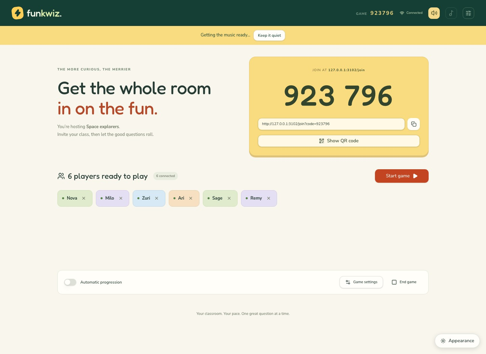](screenshots/live-lobby.jpg)

[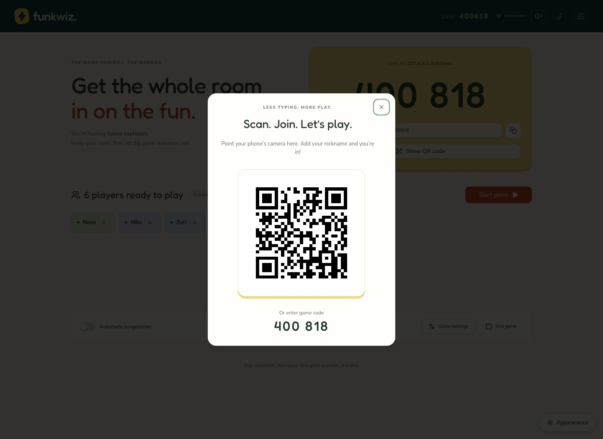](screenshots/qr-code.jpg)

These codes and QR links belong to a disposable local demo, not a public game.
Use your own reachable installation when inviting a real class.

## Set the pace together

Host with a visible countdown, pause when needed and reveal answers when the
class is ready. Question visibility can use a shared screen, student devices or both.

[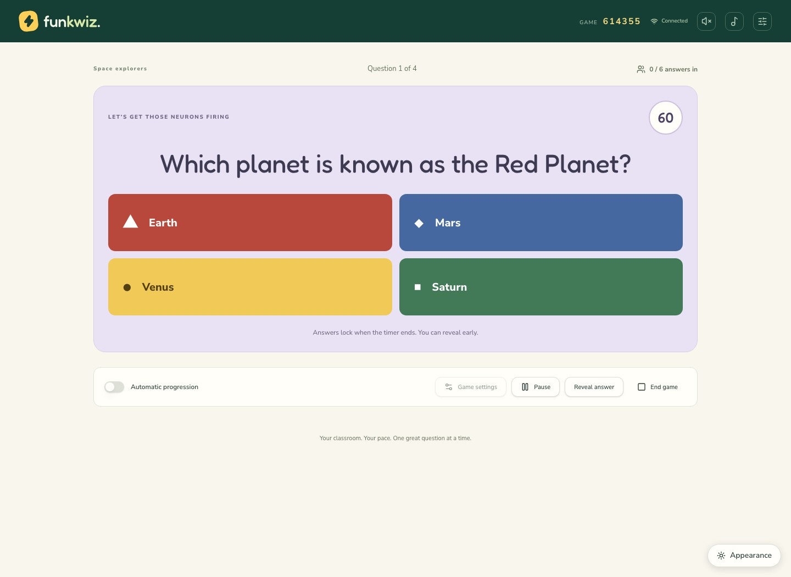](screenshots/live-question.jpg)

Students answer from their own devices without creating accounts:

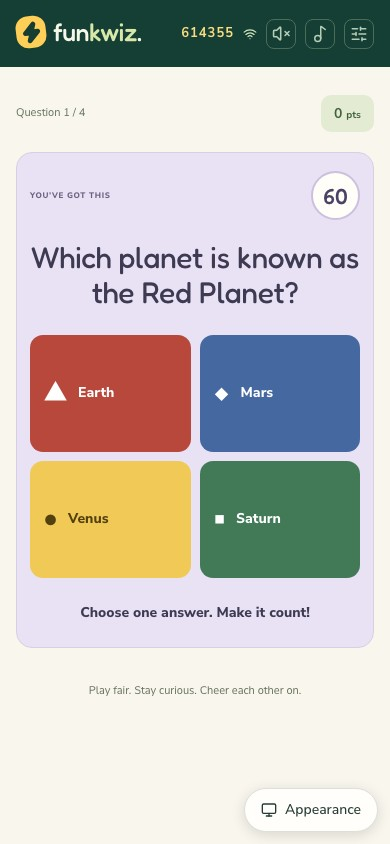

## Find the next teaching moment

Review answer accuracy, scores and question-level results after the game.
Wrong choices that received responses are red and labeled; the correct answer
is highlighted separately. These counts summarize the class.

[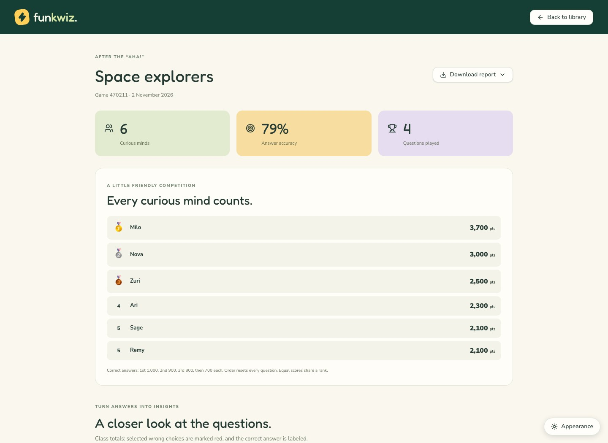](screenshots/report.jpg)

The same answer labels and theme-aware destructive colors work in dark mode:

[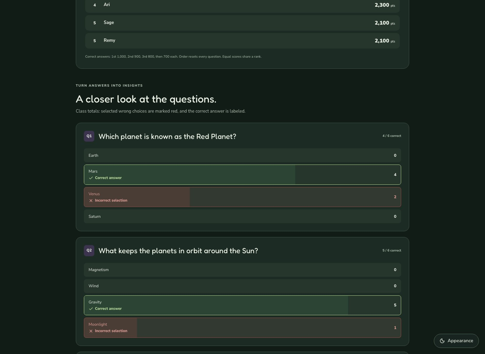](screenshots/report-dark.jpg)

Choose a branded PDF, spreadsheet-friendly CSV or structured JSON export:

[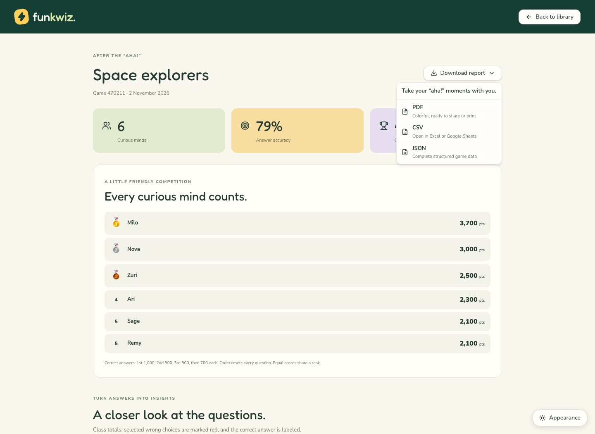](screenshots/report-export.jpg)

## Give your quiz stars a stage

The host finishes with a podium, a bronze-to-gold reveal, stage lights and a short
fanfare. Top-three players get confetti on their own results. Motion and audio
follow each device's preferences; this capture uses reduced motion.

[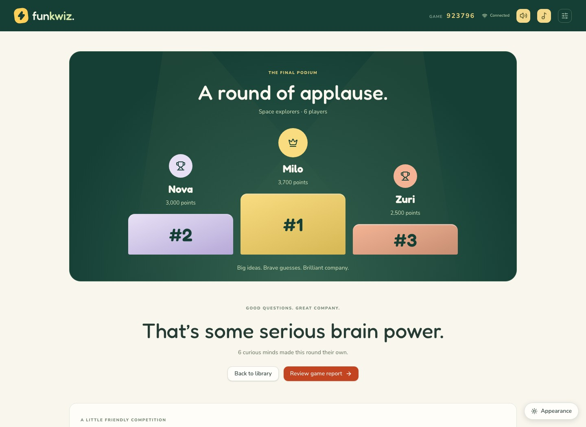](screenshots/host-podium.jpg)

## A quiz moment worth sharing

Players earn 1,000, 900 and 800 points for the first three correct answers;
all later correct answers earn 700. Order resets for each question.

At the end, **Share my result** downloads a branded PNG with the player's own
nickname, quiz title, rank out of the total players, score and correct-answer count.

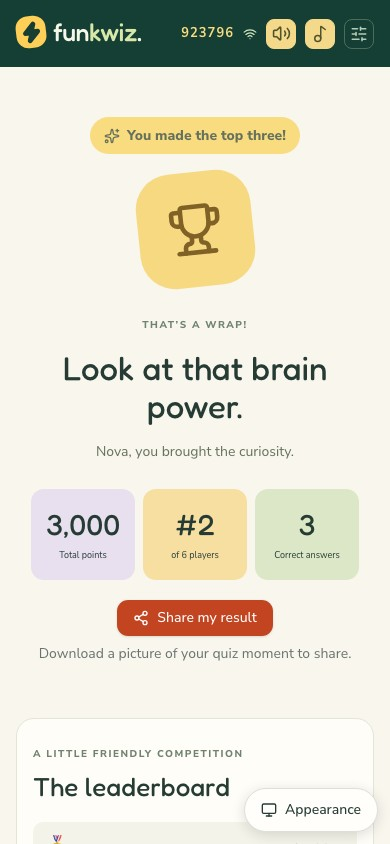

[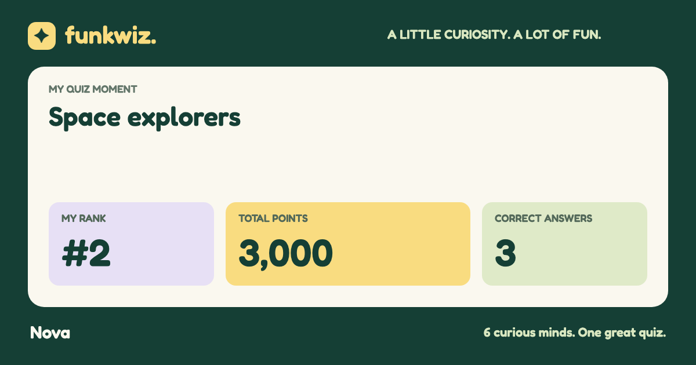](screenshots/result-card.png)

## Comfortable in light or dark

Choose light, dark or system appearance. The preference is saved on the device.

[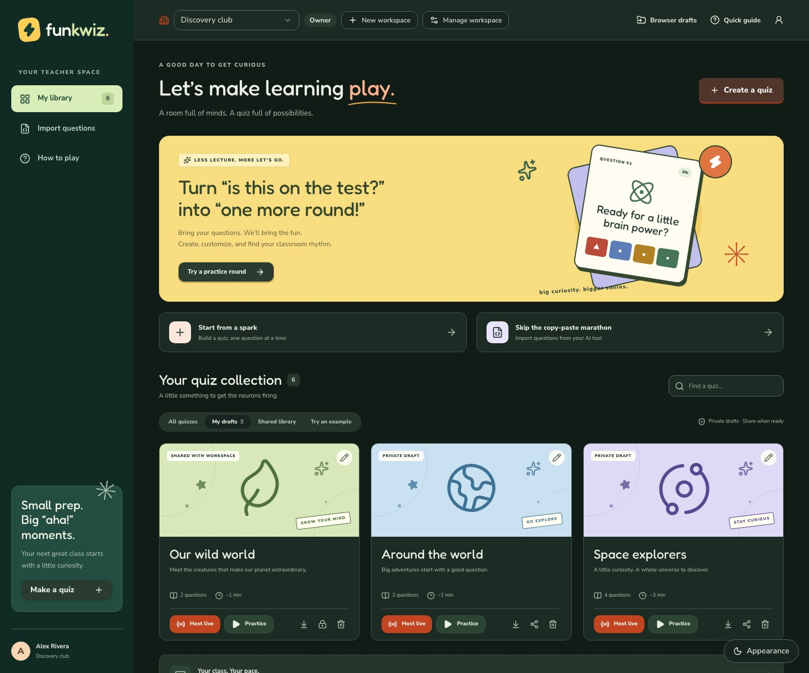](screenshots/dark-library.jpg)

## Refresh the screenshots

From a contributor checkout with Bun and Node.js installed:

```sh
bun install --frozen-lockfile
bunx playwright install chromium
bun run screenshots
```

The command starts a local Worker on `127.0.0.1:3102`, resets only the disposable
`.wrangler/e2e-school-state` database, creates the fictional classroom, and captures
the UI with Playwright. It shuts down the temporary server afterward. Keep that
port free and avoid running other browser checks concurrently.

The capture uses real quiz storage, live sockets, answer submission and report
generation. Reduced motion keeps frames settled; the development-only devtools
launcher is hidden during capture to match production. Application content is
captured directly, with no image generation or replacement data painted over it.

Screenshots are JPEGs in `docs/screenshots/`; the downloaded result card is a PNG.
All have descriptive alt text in these guides.
Keep demo identities fictional and never capture a personal installation, private
setup/invitation links, real learner reports or cloud account details for this gallery.
Update the captions and README previews when refreshing a changed feature.
